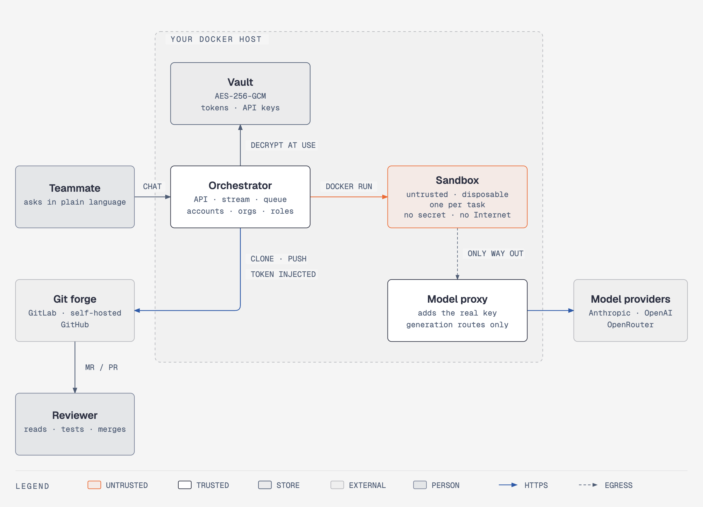
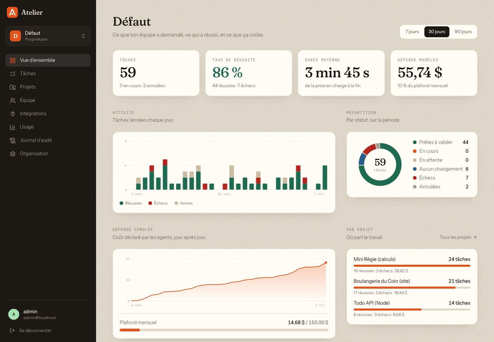
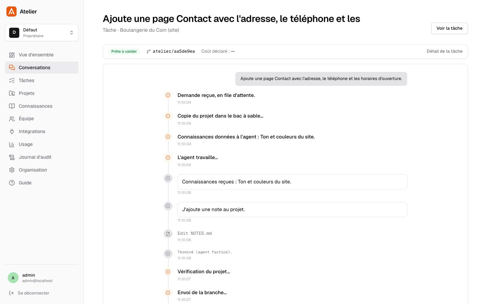
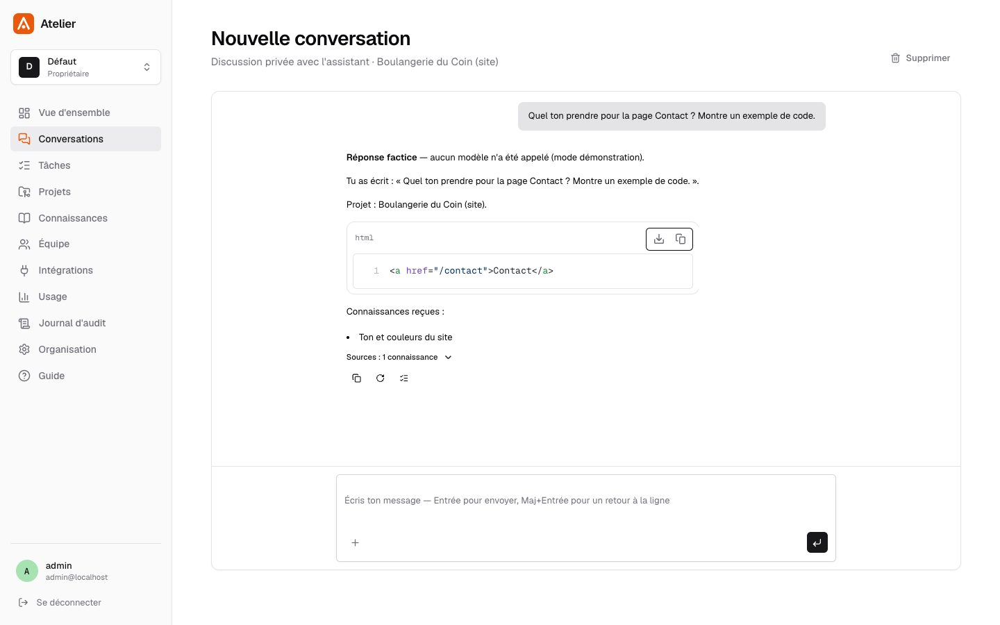
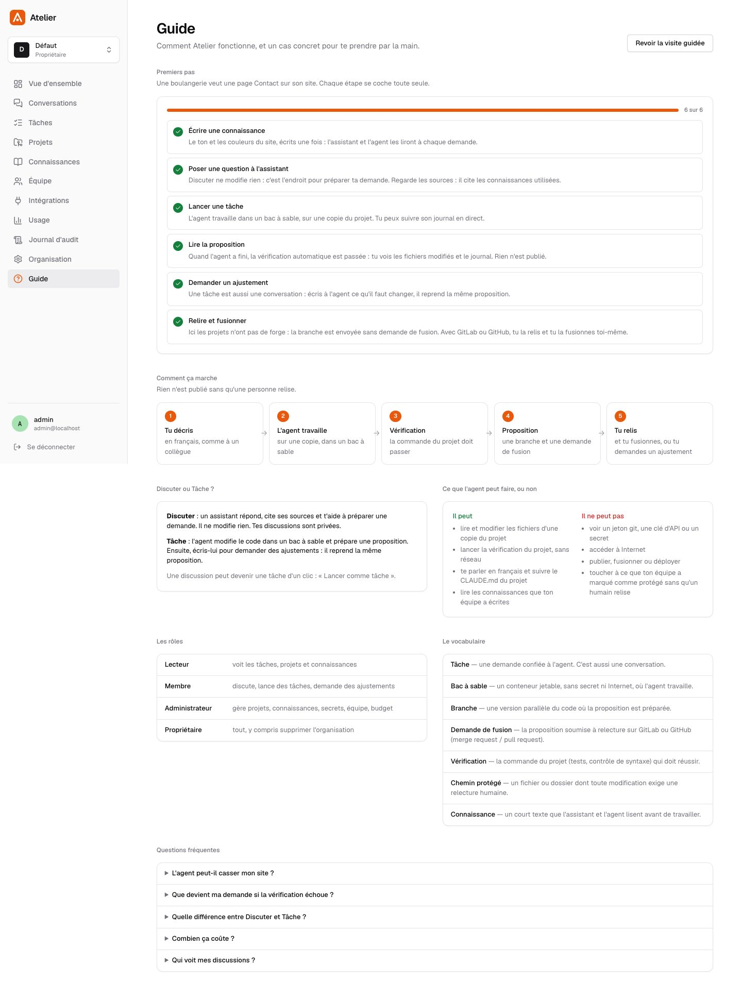
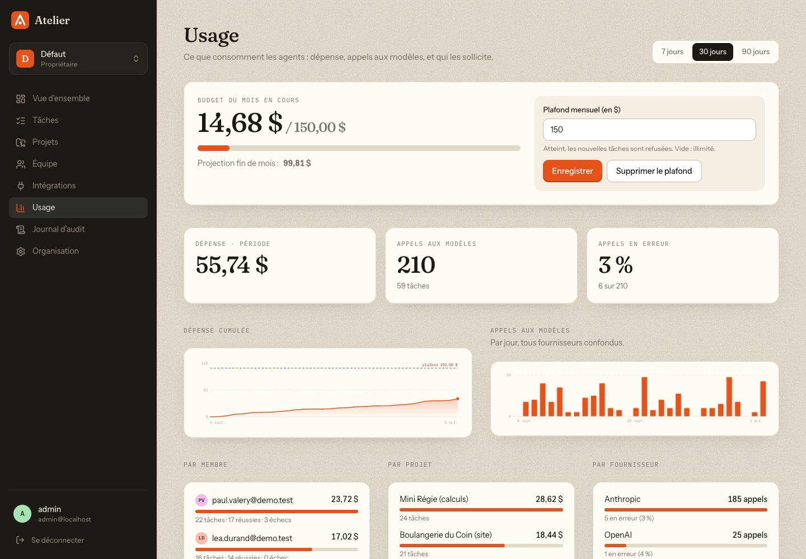
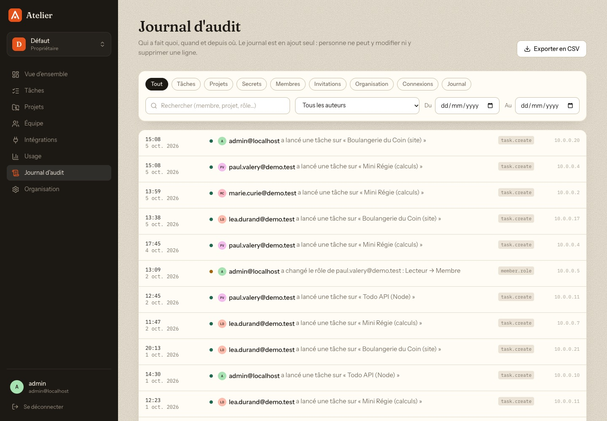

# Atelier

**Let non-developers evolve their software by talking to an AI agent — without installing anything, and without being able to break production.**

A teammate writes *"add a volume discount to the Travel tab"*. An AI agent edits the code **inside a disposable Docker sandbox**. The platform runs the project's checks, then opens a **merge request / pull request**. A human reviews and merges.

<p align="center">
  
</p>

<table>
  <tr>
    <td><a href="docs/img/app-overview.jpg"></a></td>
    <td><a href="docs/img/app-task.jpg"></a></td>
  </tr>
  <tr>
    <td><a href="docs/img/app-chat.jpg"></a></td>
    <td><a href="docs/img/app-guide.jpg"></a></td>
  </tr>
  <tr>
    <td><a href="docs/img/app-usage.jpg"></a></td>
    <td><a href="docs/img/app-audit.jpg"></a></td>
  </tr>
</table>

## The idea in four lines

- **The agent never holds a power it could abuse.** Git tokens, model API keys, pushing and merging all live in the orchestrator — plain code the agent cannot change.
- **The sandbox is disposable and blind.** One container per task, no secret, no Internet; its only way out is a proxy that adds the real API key.
- **The orchestrator controls publication.** Projects choose manual, approved or automatic delivery; protected changes and production secrets require human review.
- **Teams are isolated.** Organizations, roles, per-organization encrypted secrets and projects.

## What you can do

- **Discuss and act** with an assistant that uses your team’s knowledge. Project discussions can enable agent actions: launch a task, request an adjustment and check its status, with links to commands and logs. Discussions stay private; delegated tasks are visible to the team. Attach images, PDFs or text files.
- **Run a task**: the agent changes the code in a sandbox. A task is also a conversation — ask for adjustments and it updates the same branch and merge request.
- **Follow commands live**: open **Commandes** from a task or its conversation to see agent/check commands, their state and retained output. Commands appear at launch; output arrives on completion. The panel is read-only.
- **Organize tasks in Kanban**: switch between list and board, move cards with drag-and-drop or a selector, and keep the execution status visible. Export task and version build logs as `.log` files.
- **See where each project stands**: site health, last commit, deployment, latest task — in a project space with its own menu and breadcrumb.
- **Configure the AI per project**: team instructions, agent settings (model, turns, budget), and the repository's `CLAUDE.md`, `AGENTS.md`, rules and skills — created from templates in the editor, or written by the agent.
- **Create from an idea**: start an HTML, React or Node.js project with a managed repository; the Node starter includes accounts, SQLite and private file storage.
- **Preview and publish on Docker / Portainer**: build a version, inspect desktop/mobile screenshots, publish its artifact and restore a previous publication. Previews require an authorized session.
- **Delegate background work**: server-side tasks survive a closed browser; queued tasks reload after restart. Schedule agents with cron/timezones or let a bounded autonomous mission continue its proposal. Results arrive in a private inbox and optional Web Push.
- **Edit by hand when you prefer**: an in-browser editor (Monaco) on a private copy; it commits to a branch under the same review rules, and can polish an agent's proposal.
- **Be taken by the hand**: a welcome tour, a guide and a guided first use case (a bakery that wants a contact page).

## Quick start

**GitLab auto-hébergé + Portainer :** [note de déploiement](docs/note-deploiement.md) et [tutoriel de mise en ligne et CI/CD](docs/gitlab-portainer.md), avec registre privé, HTTPS, Keycloak, sauvegardes et mises à jour.

You need Docker. No API key and no Git server are required to try it: a deterministic fake agent and three fake projects stand in for both.

```bash
git clone <this repository> atelier && cd atelier
./scripts/demo.sh        # http://localhost:8080 — e-mail admin@localhost, password demo
                         # (seeded with 45 days of history, five members and charts to look at)
```

Ask for anything. A request containing the word **"casse"** makes the project's check fail so you can watch the agent get re-run with the error and fix it.

To run it for real (your own projects, a real model, a real forge), see **[Deployment](docs/deployment.md)** and **[Configuration](docs/configuration.md)**. On a server with Docker or Portainer it takes published images and one compose file (`docker-compose.prod.yml`). GitLab CI reuses the MyRole BuildKit/deployment templates with production and staging webhooks; the GitHub Actions pipeline remains available for GitHub hosting.

## Status

| | |
|---|---|
| Pipeline: clone → sandboxed agent → check → fix loop → branch → MR/PR | ✅ working, tested end to end with the fake agent |
| Accounts, sessions, organizations, roles, per-organization isolation | ✅ working, covered by an isolation test suite |
| Encrypted secrets, projects in the database, per-organization model keys and monthly budget | ✅ working |
| **Real Claude agent**, **real GitLab MR**, **real GitHub PR** | ⚠️ implemented, **not yet exercised** (no key or forge in the dev environment) |
| A full web application: overview, tasks, projects, team, integrations, usage, audit log, organization and account pages (light and dark, phone-ready) | ✅ working, driven in a real browser by the smoke test |
| Organizations, members, invitations, projects, secrets, budget, audit log, sessions | ✅ working, API and UI |
| Conversations: a streaming assistant (Vercel AI SDK, per-organization provider and model, set in the UI) with file attachments, a knowledge base, tasks as conversations with follow-up turns on the same branch | ✅ working, tested with a fake model and a fake local provider (no real provider call yet) |
| Dashboard health and git status, welcome tour, guide and guided first steps | ✅ working, driven in a real browser (forge deployments not exercised against a real forge) |
| Embedded code editor (Monaco): private workspaces, autosaved drafts, diff, sandboxed check, commit and push, edit an agent's branch | ✅ working, driven in a real browser ([design](docs/editor-design.md)) |
| Managed templates, Docker previews/publication/rollback, Chromium screenshots, scheduled/autonomous agents, inbox and Web Push | Implemented; Docker/local-provider validation, no real model or push-provider validation yet |
| SSO (OIDC, GitLab / GitHub sign-in), real-agent validation | 🚧 next ([roadmap](docs/roadmap.md)) |

Read **[Security → known limitations](docs/security.md#known-limitations)** before exposing it to anyone.

## Documentation

| Document | What's in it |
|---|---|
| [Architecture](docs/architecture.md) | Components, the life of a task, repository layout |
| [Security](docs/security.md) | Trust boundaries, authorization, secrets handling, known limitations |
| [Multi-tenancy](docs/multi-tenancy.md) | Organizations, roles, data model, API, implementation steps |
| [Configuration](docs/configuration.md) | Environment variables, projects, git forges, model providers |
| [Deployment](docs/deployment.md) | Docker, Portainer, reverse proxy, backups |
| [Testing](docs/testing.md) | How to run the checks, what is and is not covered |
| [Roadmap](docs/roadmap.md) | Milestones and the path to a multi-tenant SaaS |
| [Web application design](docs/ui-design.md) | The full SaaS interface: pages, stack, backend additions, phases |
| [Conversations, knowledge and the tour](docs/conversations-design.md) | One window for discussing and for tasks, a knowledge base, and a guided tour built on a use case |
| [Embedded code editor](docs/editor-design.md) | Design of an in-browser editor that commits to a branch under the same review rules (planned) |

Contributing with an AI assistant or by hand? Start with **[CLAUDE.md](CLAUDE.md)**.

## License

MIT — see [LICENSE](LICENSE).

### Budgets, technician decisions and Keycloak

Projects support a daily budget in their timezone, reservations for active work and per-call Claude cost checks. Agents and subagents have model defaults separate from the discussion assistant. When the daily limit is reached, a technician can grant 1 USD for today or wait until tomorrow, under the monthly organization ceiling. Technical questions suspend and save work, with decisions available inside Atelier and optionally through Telegram/Discord bots. Keycloak OIDC can be enabled alongside passwords, with explicit identity linking and the existing administrator roles. See [setup and boundaries](docs/deployment.md#project-daily-budgets-and-model-selection).
