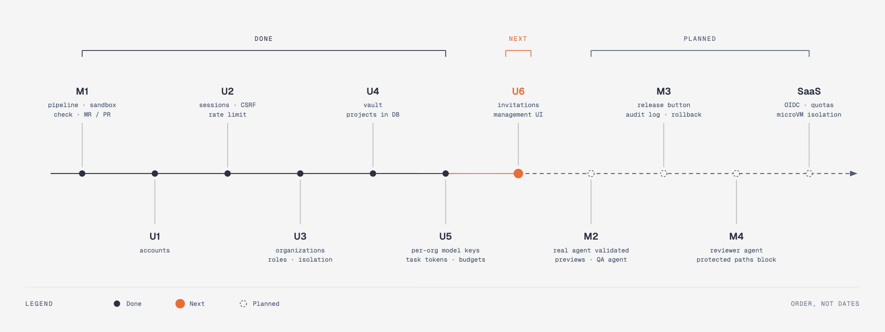

# Roadmap

| Milestone | Content | Status |
|---|---|:-:|
| **M1** | Pipeline: chat, sandbox, check and fix loop, branch, MR/PR. Multi-project, multi-forge, model proxy | ✅ |
| **U1–U5** | Accounts, sessions, organizations and roles, encrypted secrets, projects in the database, per-organization model keys with task tokens and a monthly budget — see [Multi-tenancy](multi-tenancy.md) | ✅ |
| **U6a** | Organization creation, members and invitations (API) | ✅ |
| **U6b** | Web UI for organizations, members, invitations, projects, secrets and the budget | ✅ |
| **C1–C4** | Knowledge base, discussion assistant (AI SDK, attachments), tasks as conversations with follow-up turns, dashboard health and git status, welcome tour, guide and first steps | ✅ |
| **Editor** | In-browser code editor (Monaco) that commits to a branch under the same review rules — [design](editor-design.md) | ✅ |
| **Background agents** | Persisted queue, cron/timezones, bounded autonomous missions, private inbox and optional Web Push | implemented |
| **SSO** | Keycloak OIDC alongside passwords; explicit identity linking and existing roles | implemented; real Keycloak setup remains to validate |
| **M2** | Docker previews and Chromium desktop/mobile checks | implemented; real agent validation remains pending |
| **M3** | Docker publication and artifact rollback | implemented; database rollback and immutable external audit storage remain pending |
| **M4** | Daily project budgets, per-call agent metering and technician questions via Discord/Telegram implemented; independent reviewer and organization kill switch remain pending | partial |
| **SaaS** | See below | planned |

## Current consolidation requests

| Area | Status |
|---|---|
| Command lifecycle panel, task/build log exports and readable version/task labels | implemented |
| Restricted npm installation after manifest changes | implemented; smoke test covers an existing lockfile and disabled install scripts |
| Discord text/forum topics, optional forum tags and send-only webhooks | implemented; external Discord calls tested with stubs |
| Reusing technician decisions after an agent restart | implemented; repeated tool call exercised by the Docker smoke test |
| Opt-in task actions from project discussions and task Kanban | implemented |
| Continuing new tasks on the base branch by default | pending; follow-up turns already reuse their task branch |
| Adding an external origin and exporting managed projects to Git | pending |
| Per-project custom domain configuration and DNS/TLS walkthrough | pending; platform wildcard application domains already supported |
| S3 backup settings, coherent backups and verified restores | pending |
| Multiple application services through constrained Compose, with database preservation | pending; the current runtime is a single application container with persistent data |

## Toward a multi-tenant SaaS

Going from a team tool to a public platform is not an extension of M1: **the threat model changes**. You stop running a trusted team's code and start running code for customers who do not know each other.

| Topic | Today | SaaS target |
|---|---|---|
| Authentication | Local accounts and sessions ✅ | + SSO (OIDC), "sign in with GitLab / GitHub" |
| Tenants | Organizations, roles, invitations, isolated tasks, projects and secrets ✅ (API and UI) | + per-organization audit trail |
| Git access | A token stored per organization ✅ | **OAuth / GitHub App / GitLab OAuth** per organization, minimal and revocable scopes |
| Model keys | Per organization, encrypted, injected by the proxy from a task token ✅ | + a platform key that is re-billed |
| Database | SQLite | PostgreSQL |
| Execution | Docker through a mounted socket | **gVisor or Firecracker**, a sandbox service with no Docker socket, on machines dedicated to agents |
| Agent network | Internal network + proxy | Same, plus **per-organization egress rules** and a caching package registry |
| Cost control | Ceiling per task + monthly budget per organization (on reported cost) ✅ | Live token metering in the proxy, quotas and billing |
| Concurrency | One task at a time | Worker pool, per-organization queues, fairness |
| Traceability | Events per task | Immutable audit log: who asked, which diff, who merged |

Already aligned with that target: secrets are isolated from the agent, forges are abstracted, projects are data rather than code, and the orchestrator is the only trusted zone.
