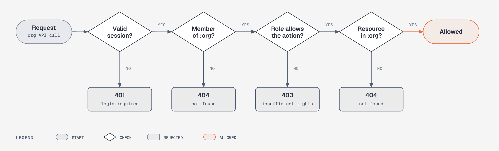
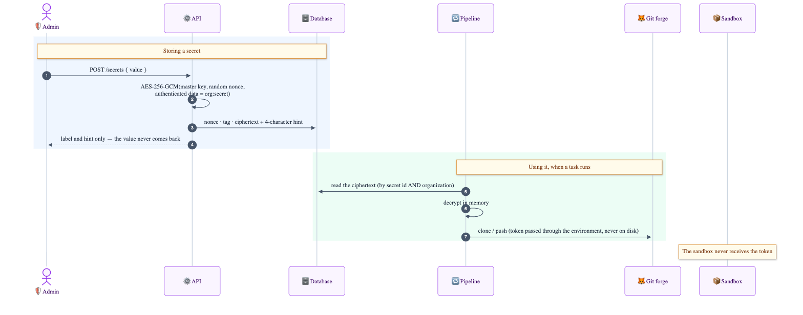

# Security

## Principle

**The agent never holds a power it could abuse.** Everything sensitive — model API keys, git tokens, pushing, opening merge requests — lives in the orchestrator, which is ordinary code the agent cannot modify. The agent only gets what it needs to edit files inside its own container.

| The agent can… | The agent cannot… |
|---|---|
| read and edit the files of a disposable copy of the project | see a git token, an API key or any production secret |
| run commands *inside its container* | reach the Internet (internal-only network) |
| talk to the model through the orchestrator's proxy | push, merge or deploy |
| | touch the `.git` directory (kept out of its sight) |

The sandbox runs as a non-root user with `--cap-drop ALL`, `no-new-privileges`, 1 CPU, 1 GiB of memory and a 512-process limit. **This is container-grade isolation, not virtual-machine isolation** — see the limitations below.

## Authorization

Every request under `/api/orgs/:org/…` goes through the same decision, in this order:

- The organization comes from the URL but is **never trusted**: the role is looked up for *this user in this organization*.
- A non-member gets **404**, never 403, so the existence of an organization is not revealed.
- Resources are fetched by **(id, organization)**, never by id alone. Guessing another organization's exact task id, project id or secret id yields 404.
- The permission table is a single file: [`orchestrator/src/access.ts`](../orchestrator/src/access.ts).

This is covered by `isolation.test.ts` and `resources.test.ts`, which start a real HTTP server with several users in two organizations.

## Secrets

- **AES-256-GCM** with a random nonce per secret. The organization id **and** the secret id are *authenticated data*: a ciphertext copied to another organization or another secret fails to decrypt.
- The master key comes from `ATELIER_MASTER_KEY`, or is generated next to the database (mode `600`) on first start. **Losing it makes every secret unreadable — back it up separately from the database.**
- The API never returns a secret, only a label and a 4-character hint. Listing queries do not even select the ciphertext column.
- Tokens are passed to git through `GIT_CONFIG_*` environment variables: they appear in no command line, no URL, no `.git/config` and no file the agent can read.

## Design choices that each close an attack

- **`.git` lives outside the mounted directory.** Otherwise the agent could write a `.git/config` (`core.fsmonitor`, `core.sshCommand`) or a hook that the orchestrator's git — which carries the token — would execute. The repository is cloned with `--separate-git-dir`, git is always called with explicit `--git-dir/--work-tree`, `core.hooksPath=/dev/null` and `core.fsmonitor=false`, and any `.git` the agent creates is removed.
- **The orchestrator runs the checks itself**, without network and outside the agent. The agent's claim that "the tests pass" is never trusted.
- **Model keys stay in a proxy.** The sandbox receives a **one-time task token** instead of a key. The proxy resolves token → task → organization, checks the organization's budget, allows only generation routes and injects *that organization's* key. It never falls back to another organization's key or to an environment variable, and the token is revoked when the task ends.
- **The Docker client runs with a minimal environment**, so none of the orchestrator's own secrets can be forwarded into a sandbox.
- **Repositories must be `https://` URLs without embedded credentials**, optionally restricted to an allowlist of hosts (`ATELIER_GIT_HOSTS`). Local paths and exotic schemes would let a user read files from the host. Branch names cannot start with `-` or contain `..`, so they cannot be mistaken for git options.
- **Protected paths.** If the diff touches a project's `protectedPaths` (migrations, CI config…), the MR/PR is titled `[REVIEW REQUIRED]` and says so.
- **A strict Content-Security-Policy and friends on every response.** Scripts, styles, fonts and images come from the application itself (`default-src 'self'`, no inline script, no `eval`). Styles accept a **single-use nonce** the server puts in the entry page (the code editor creates `<style>` elements and tags them with it); never `unsafe-inline`. Two narrow exceptions serve the chat: `wasm-unsafe-eval` (code highlighting compiles a WebAssembly module; it does not allow `eval()` on text) and `blob:` for the preview and reading of a file chosen before sending, the page cannot be framed (`frame-ancestors 'none'`, `X-Frame-Options: DENY`), referrers are not sent, and `Strict-Transport-Security` is added over HTTPS. API responses are never cached (`no-store`).
- **Discussions are private.** A conversation in Discuss mode is readable only by its author — an admin or owner gets a 404 like anyone else. Task conversations are visible to the whole organization, like tasks. The server keeps the history: whatever earlier messages a browser sends are ignored, so a client cannot forge what the assistant "said".
- **Chat actions are opt-in per project discussion.** The assistant can launch one task or adjustment per stored user message and read a task’s status. Tools bind organization, project and actor on the server, recheck enablement/roles before executing, reject secrets and use the usual task budgets. Regenerating a response reuses its action instead of launching another task. Disabling actions prevents subsequent executions, including tools from an in-flight response; an already launched background task keeps running until cancelled through the task controls. The delegated task receives the discussion’s context and is visible to the organization. No shell or publication endpoint is exposed to the chat process.
- **Kanban is an organization layer.** Only a task’s requester with member rights, or an administrator, can move its card. A move changes `board_column`, never its execution status. Pending technician decisions always appear in the blocked column.
- **Attachments are hostile input.** At most 4 files of 4 MB (8 MB per message). The real content is checked against the declared type (magic bytes for images and PDFs), text files are inlined inside a fence longer than any fence they contain, binaries disguised as text are refused, and remote URLs are never fetched. Files are stored with the message.
- **Project instructions are context too.** Written by admins (4000 characters), given to the agent and the assistant after the platform rules, and said so in their prompt; they cannot widen a power. The repository's AI files are read through an allow-list of paths (`CLAUDE.md`, `AGENTS.md`, `.claude/rules/*.md`, `.claude/skills/*/SKILL.md`, `.claude/agents/*.md`): nothing else of the repository is readable from there, and only by members.
- **Knowledge is context, never authority.** It is written by admins and handed to the model and the agent as data; it cannot widen what the agent may do (the sandbox has nothing to give). The runner tells the agent so.
- **The health monitor cannot be turned into a scanner.** The server visits only `http(s)` addresses an admin typed, checks the address **at connection time** (and for literal IPs, which skip name resolution), always refuses link-local ranges (cloud metadata), refuses private and local ranges unless the host sets `ATELIER_HEALTH_ALLOW_PRIVATE=1`, does not follow redirects and never reads or stores a response body. Only the status code, latency and a short fixed error are kept.
- **Static files cannot leak.** The application's files are served from one folder; `../`, percent-encoded separators and null bytes are rejected, and a missing asset is a 404 rather than the HTML page. This is tested with raw requests.
- **The interface only hides what the server would refuse.** Admin pages redirect other roles away and buttons are greyed out, but every route is authorized on the server regardless.
- **CSRF.** Session cookies are `HttpOnly; SameSite=Strict`, and state-changing requests are rejected when `Origin` does not match the host.
- **Sessions.** 256-bit random token; only its SHA-256 is stored, so a database leak cannot be replayed. Sliding 7-day expiry, revoked on logout and on password change.
- **Audit log.** Every state-changing action is recorded (actor, organization, target, details, IP) in an append-only table that no route can edit or delete, readable by admins and exportable as CSV with spreadsheet-formula cells neutralized. Details never contain a secret value, a password or an invitation link — a test scans the whole log for them. Sign-in attempts on unknown accounts leave no trace.
- **Sessions you can see.** Each person can list their active sessions (browser, IP, last use) and revoke any of their own; a session is named by a prefix of its hash, never by its token.
- **Deleting an organization** is owner-only, needs the exact name, is refused while tasks are queued or running, and runs in one transaction (everything it owns goes; user accounts stay).
- **Invitations.** The link token is random, single-use, expires in 7 days and is stored only as a SHA-256. Roles can only be granted at or below the granter's own, only an owner can touch an owner, and the last owner cannot be demoted or removed.
- **Passwords.** scrypt with a per-user salt, parameters stored with the hash, bounded length, 8-character minimum. Login runs a hash even for unknown accounts and returns the same message, so timing and wording do not reveal which accounts exist. Failed logins are rate-limited per IP and per e-mail.

## Known limitations

Read these before exposing the service.

- **The Docker socket is mounted into the orchestrator, which is equivalent to root on the host.** Acceptable for a trusted team on a dedicated machine; **not acceptable for a multi-tenant SaaS** with mutually untrusting customers. A filtering socket proxy helps; microVM isolation (gVisor/Firecracker) fixes it properly. See the [roadmap](roadmap.md).
- **Spend is controlled coarsely.** The monthly budget counts the cost agents *report* per task, so one running task can overshoot it by up to `MAX_BUDGET_USD`. Tokens are not metered live in the proxy yet.
- **Invitations are links you hand over yourself** — nothing is e-mailed, so whoever receives the link can use it until it expires or is revoked (an existing account must also match the invited address).
- **The web UI is French only**, and there is no SSO yet (local accounts only).
- **Rate limiting is in memory**: it resets on restart and does not span several instances.
- **No egress filtering of the orchestrator.** A user who may create projects can make it clone from any allowed `https` host; set `ATELIER_GIT_HOSTS` to restrict it.
- **The sandbox has no general Internet access.** The orchestrator can install public npm dependencies through a separate scoped proxy. Lifecycle scripts and external registries remain blocked.
- **Cap the keys in the provider's console too.** Per-task limits (`MAX_BUDGET_USD`, turns, time) and the monthly budget are Atelier's own and rely on what the agent reports.
- **Task tokens live in memory**, so only one orchestrator process can serve the proxy.
- **One task at a time.**
- **Chat dollar estimates require configured input/output token prices.** With a monthly cap and no prices, real chat calls are refused. Cached-token discounts are not modeled. Budget metering still trusts provider/agent usage reports and is not a prepaid billing system.
- **Attachments live in the database** with their message; large uploads grow it. A message-level quota and external storage are not built.
- **Image and PDF attachments depend on the provider and model** accepting them; this has only been exercised with the fake model.
- **The real Claude agent and real GitLab/GitHub calls have not been exercised yet**; they are implemented but verified only through the fake agent and local git repositories.
- Serve it behind **HTTPS**. Set `TRUST_PROXY=1` behind a reverse proxy so cookies are marked `Secure` and client IPs are read correctly.

## Background agents, previews and application publication

The new execution paths keep the same trust boundary and add these controls:

- Scheduled agents recheck the responsible user's current role and organization budget on every trigger. Autonomous runs have a daily cap, no overlap on the project and stop conditions (failure, no changes, ten turns). They have no extra publication privilege.
- Installation and model calls use **different, short-lived token capabilities**. A model token cannot reach the npm proxy; an installer token cannot reach a model. The npm proxy permits GET only, pins the upstream to the public registry, refuses redirects and never forwards a real secret. npm lifecycle scripts are disabled.
- Containers use an internal network, non-root uid, dropped capabilities, `no-new-privileges`, resource limits and a disabled external DNS upstream. Build/check containers have no network. Every application version's preview and production containers have **separate internal networks**; applications from different projects cannot connect to one another directly.
- Previews are **private by default**. Access requires an organization member, a one-time 30-second exchange and an HttpOnly preview cookie. The preview session is tied to the platform session: logout/revocation invalidates it. Tokens are not put in URLs or local storage. HTTPS embeddings use partitioned cookies; browser cookie restrictions may prevent an embedding, and access fails closed.
- Application container logging is disabled to avoid retaining runtime secret values in Docker logs. The application gateway strips platform/preview cookies before forwarding to the application, prevents applications from setting those reserved cookies, strips cookie Domain attributes, refuses external redirects and removes reporting/preload headers. Its CSP permits same-origin resources and API calls only; third-party scripts, images, fonts, frames, forms and fetch destinations are blocked. DNS prefetch is disabled and application responses are not cached.
- HTTPS platform sessions use a `__Host-` cookie, preventing another subdomain from injecting a competing session cookie. Existing HTTPS users must sign in again after this upgrade.
- The secret scanner blocks sensitive filenames, private-key/token patterns, known vault/runtime values and escaping symlinks before sending a repository to an agent, pushing changes or publishing artifacts. The AI context is also checked for recognizable secrets and values from the vault. A detector can have false positives and cannot recognize every possible secret or a secret visible only in an image.
- New task command events mask recognizable secrets and a snapshot of the organization's vault/runtime/bot and platform values before persistence or SSE delivery. Terminal controls are removed and output is bounded. The command panel is read-only and reuses the existing task authorization; historical events are not rewritten. This detector cannot recognize every encoding or unknown credential.
- Production values are encrypted with project/environment/name as authenticated context, never returned through the API, and are not injected into builds or agent containers. Automatic publication pauses at the review boundary when production secrets are configured. Runtime application code can use its own secrets; a human must review how that code exposes data over HTTP.
- Forge requests refuse redirects and pin DNS to checked addresses. Private git hosts require both `ATELIER_GIT_ALLOW_PRIVATE=1` and an explicit `ATELIER_GIT_HOSTS` entry. Link-local/metadata addresses, including IPv4-mapped IPv6 spellings, are always refused. Git's child environment no longer inherits platform API keys or the master key.
- Push subscriptions accept only known browser push services. Push payloads contain generic text, never project names, prompts or secrets. Retryable delivery is stored in an outbox; expired endpoints are removed.
- Each agent-to-model request is limited to 10 MB of JSON and scanned before forwarding, including decoded string values, JSON keys, query parameters and permitted provider headers. Recognizable secrets and known vault/runtime values are refused without echoing their content. Correction prompts are checked again after tool/check output is added. This cannot detect every encoding or a secret hidden inside an image.
- Cancellation immediately revokes the task and current install capabilities and aborts their active model/registry requests. The pipeline rechecks cancellation and the requester's current role after checks and before push/PR steps. The model proxy also rechecks the role and running state of the backing task before each forwarded request. A cancelled follow-up keeps its previous remote proposal. A push or forge request already in flight cannot be undone by cancellation; work already processed by the provider may still be billed.

**Boundaries:** model providers still receive the code/context needed for the AI request. The public application intentionally returns its own authorized data to its visitors. CSP and container networking do not prove that arbitrary generated business logic will never return a secret in an HTTP response. Docker shares a host kernel and the orchestrator still controls the Docker socket. Treat this as hardened isolation for a trusted team, not a guarantee of zero exfiltration or a replacement for microVM isolation and an independent security audit before public multi-tenant use.

Technical references: [Docker internal networks](https://docs.docker.com/reference/cli/docker/network/create/), [Docker security](https://docs.docker.com/engine/security/), [Git HTTP/DNS settings](https://git-scm.com/docs/git-config).

## Budgeted workers, technician decisions and SSO

Daily project limits include active execution reservations and project-scoped chat expenses. The proxy applies per-call provisions using a dated Claude tariff catalogue; unpriced models/modifiers/server tools are refused for budgeted agents. Complete provider usage releases unused call provisions; unknown interrupted spend retains a conservative charge. This is local accounting, not a guarantee against tariff changes or charges incurred elsewhere with the same provider account. A technician extension adds exactly 1 USD to the current local day and never changes the organization monthly limit.

Technician questions have bounded numbered choices, task/turn bindings, expiry and audited answers. Telegram/Discord credentials are encrypted, never enter a sandbox and are included in secret detection along with platform credentials. Incoming replies must match both an allowed technician ID and a delivered message in the configured channel. For Discord forums, only messages retrieved from the topic created for that decision are considered. The channel configurator must still have administrative authority. Bots cannot execute commands or publish. Message bodies and forum titles are generic by default; administrators explicitly opt into sending the question and options to an external service. Discord webhooks are send-only: decisions remain in the authenticated Atelier UI. Their URLs are encrypted, restricted to the official HTTPS Discord endpoint and never followed through redirects; webhook URLs and their token components are included in secret detection.

Keycloak uses OIDC Authorization Code with PKCE S256, state, nonce, browser binding and verified RS256 ID-token signatures. All provider endpoints are HTTPS on the configured issuer's origin, with redirects refused. Verifiers are encrypted and expire after ten minutes; callbacks are single-use. Association requires an existing local login, a still-valid original session and a matching verified e-mail; e-mail equality alone never links identities. Authentication uses issuer/subject; privileges remain in Atelier. No provider access/refresh tokens are stored. Classical password login remains available, and existing Atelier sessions must be revoked separately when suspending an IdP user.

The web package pins patched transitive versions of `linkify-it` (5.0.2), DOMPurify (3.4.17) and KaTeX (0.18.2) through npm overrides. Keep them until the parent libraries declare compatible patched versions. Terminal ANSI/link escaping and untrusted math links have regression tests; Monaco's actual editor is exercised in the Docker browser suite. An npm audit is a dependency advisory check, not a proof that the application has no vulnerabilities.
